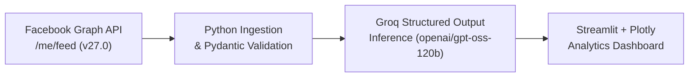

Watch it live on:https://fb-sentiment.onrender.com
# PagePulse — Facebook Page Sentiment & Engagement Analytics


PagePulse connects to the Meta Graph API (`v27.0`) to ingest Facebook Page feed posts, reaction counts, and user comments. It routes each post's comment thread through Groq LLM inference (`openai/gpt-oss-120b`) with Pydantic-validated structured JSON outputs to classify comment-level sentiment and derive a per-post verdict. Results are surfaced in a custom dark-mode Streamlit + Plotly dashboard with interactive engagement charts and a full post-by-post AI audit feed.

> Built by [Sajag Niroula](https://github.com/buildwithsajag) · [@buildwithsajag](https://github.com/buildwithsajag)

---

## Key Features

- **On-demand feed ingestion** — pulls posts from `/me/feed` with reactions and nested comments via a single Graph API request; no background polling, all results cached in `st.session_state` until the next manual sync.
- **Structured LLM sentiment classification** — Groq inference with a Pydantic JSON schema (`PostReviewAnalysis`) produces per-comment labels (Positive / Negative / Neutral) and an overall post verdict (Positive / Negative / Mixed / No Comments) with a one-line summary.
- **Interactive Plotly visualizations** — Sentiment Breakdown Donut Chart and a grouped bar chart of Reactions vs. Comments per post, both rendered with a consistent dark theme.
- **`st.session_state` caching** — analysis results persist across UI interactions (tab switches, expander toggles) without re-hitting the APIs; re-fetch only on explicit button click.
- **Custom dark-mode SaaS UI** — hand-crafted CSS with KPI stat cards, sentiment badges, post feed cards, and an empty-state callout on first load.

---

## Architecture & Data Flow



| Step | Detail |
|---|---|
| **Ingest** | `GET /me/feed` with fields `id, message, created_time, reactions.summary(true), comments{message,created_time}` |
| **Validate** | `CommentSentiment` and `PostReviewAnalysis` Pydantic models enforce the response schema |
| **Classify** | Groq `chat.completions.create` with `response_format: json_schema` — zero post-processing required |
| **Render** | Streamlit reruns are gated by `run_sync` button; session state prevents redundant API calls |

---

## Tech Stack

| Layer | Technology | Role |
|---|---|---|
| Data source | Meta Graph API v27.0 | Page feed posts, reactions, and comments |
| HTTP client | `requests` | Graph API calls |
| LLM inference | Groq (`openai/gpt-oss-120b`) | Comment-level and post-level sentiment classification |
| Output schema | Pydantic v2 | Structured JSON validation for LLM responses |
| Dashboard | Streamlit | App framework, session state, layout |
| Charts | Plotly (`graph_objects`) | Donut and grouped bar charts |
| Data wrangling | pandas | Post engagement DataFrame for chart traces |
| Config | python-dotenv | `.env` credential loading |

---

## Prerequisites

### 1. Meta Developer App & Page Access Token

1. Go to [developers.facebook.com](https://developers.facebook.com) and create a new app. Select **Other** → **Business** as the app type.
2. Inside your app dashboard, click **Add Use Case** and select **"Manage everything on your Page"**.
3. Under **Permissions**, add the following three permissions and request **Advanced Access** for each:
   - `pages_show_list`
   - `pages_read_engagement`
   - `pages_read_user_content`
4. Open **Graph API Explorer** (`developers.facebook.com/tools/explorer`), select your app, and choose your Page from the **User or Page** dropdown to get a **Page Access Token**.
5. To generate a long-lived (60-day) token, exchange your short-lived token via:
   ```
   GET https://graph.facebook.com/oauth/access_token
     ?grant_type=fb_exchange_token
     &client_id={app-id}
     &client_secret={app-secret}
     &fb_exchange_token={short-lived-token}
   ```
6. Copy the resulting Page Access Token — this is your `FB_PAGE_TOKEN`.

> **Note:** For production use, implement a token refresh flow or use a System User token via Meta Business Manager for non-expiring access.

### 2. Groq API Key

1. Sign up at [console.groq.com](https://console.groq.com).
2. Navigate to **API Keys** and create a new key.
3. Copy the key — this is your `GROQ_API_KEY`.

---

## Local Installation & Usage

```bash
# 1. Clone the repository
git clone https://github.com/buildwithsajag/pagepulse.git
cd pagepulse

# 2. Create and activate a virtual environment
python -m venv .venv
source .venv/bin/activate        # Windows: .venv\Scripts\activate

# 3. Install dependencies
pip install streamlit groq requests python-dotenv pydantic plotly pandas

# 4. Configure credentials
cp .env.example .env
# Edit .env and fill in your tokens (see below)

# 5. Run the dashboard
streamlit run app.py
```

### `.env` template

```env
FB_PAGE_TOKEN=your_page_access_token_here
GROQ_API_KEY=your_groq_api_key_here
```

On first load, the dashboard shows an empty-state prompt. Click **↻ Sync & Analyze** in the top-right to fetch your feed and run sentiment analysis. Results are cached for the session — click the button again to re-sync.

---

## Project Structure

```
pagepulse/
├── app.py            # Streamlit app — ingestion, inference, and dashboard UI
├── .env              # Local credentials (never commit this)
├── .env.example      # Credential template for contributors
├── requirements.txt  # Python dependencies
└── README.md         # This file
```

### `requirements.txt`

```
streamlit
groq
requests
python-dotenv
pydantic
plotly
pandas
```

---

## Notes & Limitations

- The `/me/feed` endpoint returns a maximum of 25 posts per request by default. Pagination is not currently implemented — extend `fetch_facebook_posts()` with cursor-based iteration for high-volume pages.
- Groq structured output inference is synchronous and sequential per post. For large feeds, consider batching or async calls.
- The Meta Graph API token scope requires that the authenticated user have an **Admin** or **Editor** role on the target Facebook Page.

---

## License

MIT
